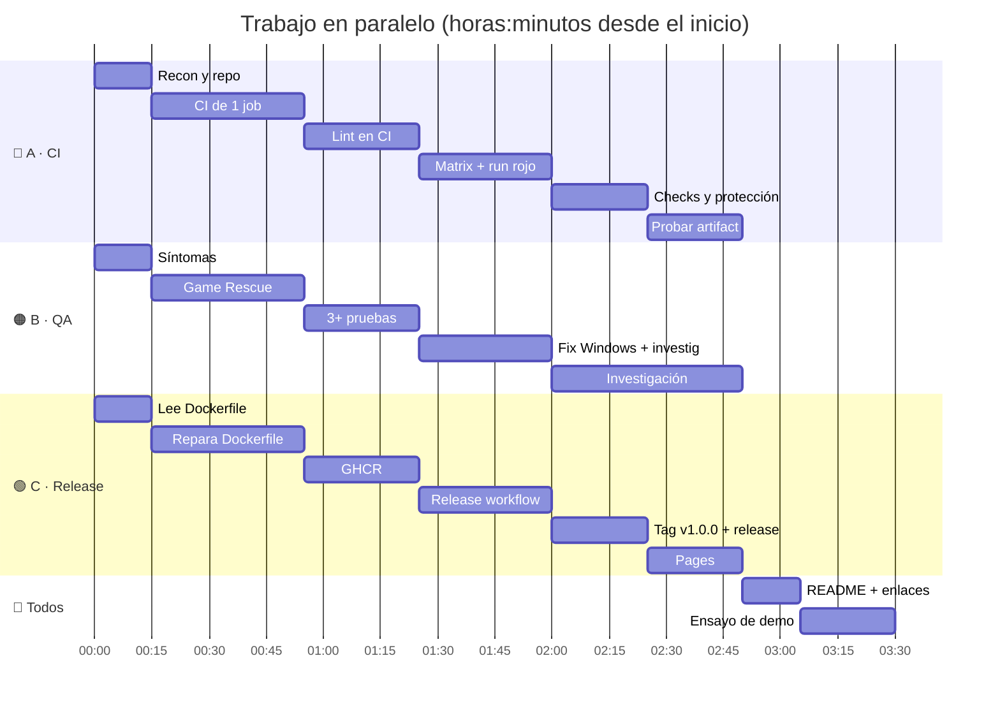

<div align="center">

# 🕹️ Arcade Rescue
### De build roto a release · Guía detallada de equipo


**Prioridad si falta tiempo:** `build` → `pruebas` → `CI` → `release` → `Docker` → `Pages`

</div>

> [!IMPORTANT]
> Todo se demuestra **con enlaces de GitHub** (runs, artifacts, releases, paquetes, URLs). Una captura de tu terminal local no cuenta como evidencia. Los workflows se escriben **a mano** y todos tienen que poder explicarlos.

## 📑 Contenido

1. [Lo que ya encontramos en el código](#-lo-que-ya-encontramos-en-el-código)
2. [Equipo y reglas](#-equipo-y-reglas)
3. [Cronograma](#️-cronograma-210-min)
4. [Etapas paso a paso](#-etapas-paso-a-paso) (quién hace qué)
5. [Definición de terminado](#-definición-de-terminado)
6. [Demo](#-demo)
7. [Investigación](#-investigación-obligatoria)
8. [Retos opcionales](#-retos-opcionales-tope-10)

---

## 🔎 Lo que ya encontramos en el código

Esto salió de leer `CMakeLists.txt`, `Dockerfile`, `README.md` y `tests/`. Son **pistas**: confírmenlas ustedes reproduciéndolas antes de arreglarlas (la regla es no «arreglar» lo que no se reproduce).

| # | Dónde | Qué pasa | Quién lo ve |
|:-:|---|---|:-:|
| 1 | `CMakeLists.txt` | Pide `CMAKE_CXX_STANDARD 14`, pero la actividad exige **C++17** | 🔵 |
| 2 | `CMakeLists.txt` | **No tiene `enable_testing()` ni `add_subdirectory(tests)`**: por eso `ctest` dice que no hay pruebas | 🔵 + 🟠 |
| 3 | `CMakeLists.txt` | Busca raylib `4.5` con `find_package`, pero descarga el tag `6.2`: versiones inconsistentes | 🔵 |
| 4 | `CMakeLists.txt` | Descarga raylib de internet con FetchContent: el build en una máquina limpia puede tardar o fallar | 🔵 |
| 5 | `Dockerfile` | `apt-get install` **sin `-y`** (el build se queda esperando una respuesta y «no termina») | 🟢 |
| 6 | `Dockerfile` | Compila solo `src/main.cpp` con `g++`, **ignorando CMake**; no enlaza el resto de los `.cpp` | 🟢 |
| 7 | `Dockerfile` | `ubuntu:latest` sin versión fija; no ejecuta pruebas ni `--headless` | 🟢 |
| 8 | `README.md` | El comando heredado `g++ … src/main.cpp` no funciona; hay que documentar el build real con CMake | 🟢 |
| 9 | `tests/test_smoke.cpp` | Solo 2 pruebas de humo y no corren en el pipeline | 🟠 |
| 10 | Informe de QA | «La comida aparece donde ya está la serpiente», «el marcador no cuadra», «la partida no termina cuando debería», «la fuente pixel no carga desde `build/`» | 🟠 |

> [!NOTE]
> El juego ya trae la opción `ARCADE_RESCUE_SANITIZERS` (ASan/UBSan) en CMake y el modo `--headless`. Eso ayuda mucho a la investigación y al contenedor.

---

## 👥 Equipo y reglas

| | Persona | Rol | Es dueño de… |
|:-:|---|---|---|
| 🔵 | **A:** ___Diego___ | Build master y CI | `CMakeLists.txt` · `.github/workflows/ci.yml` · `.clang-format` · `.clang-tidy` |
| 🟠 | **B:** ___Claudio___ | QA y Game Rescue | `src/` · `include/` · `tests/` · `docs/investigacion.md` |
| 🟢 | **C:** ___Angel___ | Release, Docker y Pages | `Dockerfile` · `.github/workflows/release.yml` y `docker.yml` · `docs/` (sitio) · `README.md` |

**Reglas para no pisarse:**

- 🌿 **Una rama por tarea**: `fix/…`, `ci/…`, `docker/…`, `docs/…`. Nadie trabaja directo en `main`.
- 🔀 **Todo entra por Pull Request** y lo revisa otra persona (aunque sea rápido).
- 🧾 **Un commit = una intención**: `fix:`, `ci:`, `test:`, `docs:`, `chore:`. «cambios» o «fix» a secas no sirven.
- 🚫 Nada de `build/`, binarios ni secretos en el repo.
- 🗣️ Si necesitas tocar un archivo ajeno, **avisa primero** (por ejemplo, B necesita cambiar `CMakeLists.txt` para enganchar los tests: se lo pide a A).
- ⏰ Atascado más de **10 min**: rotar roles o pedir pista.
- 🤖 Si usan IA, lo declaran en el README y deben poder explicar lo que se entregó.

---

## ⏱️ Cronograma (210 min)



| Min | 🔵 A | 🟠 B | 🟢 C |
|---|---|---|---|
| **0–15** | **Todos:** clonar, compilar tal cual, anotar lo que falla. A prepara el repo. | Lista de síntomas | Lee el Dockerfile y guarda sus errores |
| **15–55** | Primer workflow (1 job, Linux) | Reproducir y corregir bugs | Reparar el Dockerfile |
| **55–85** | Lint dentro del CI | Escribir 3+ pruebas | Workflow que publica en GHCR |
| **85–120** | Matrix Linux/Windows + run rojo | Arreglar fallos de Windows; empezar investigación | Workflow de release y artifacts |
| **120–145** | Checks obligatorios en `main` | Investigación | Tag `v1.0.0` y release |
| **145–170** | Descargar y ejecutar un artifact | Terminar investigación | `docker pull` y Pages |
| **170–185** | **Todos:** README, enlaces, revisión final | | |
| **185–210** | **Todos:** ensayo cronometrado | | |

---

## 🧭 Etapas paso a paso

Cada etapa dice **quién lidera**, **qué hace cada persona**, **cómo** y **cuándo está lista**. Los comandos son los de la actividad; el YAML de los workflows lo escriben ustedes.

### Etapa 1 · Reconocimiento `0:00 – 0:15` 👥 todos

**Objetivo:** ver el estado real del proyecto **sin tocar nada** y dejar la base lista.

| | Qué hace |
|:-:|---|
| 🔵 **A** | Confirma que todos clonaron el repo. Crea/revisa el `.gitignore` (`build/`, binarios, secretos). Compila con los comandos de abajo y **guarda la salida completa** (errores y warnings) en un archivo de texto para el informe. |
| 🟠 **B** | Corre `ctest` y la versión `--headless`; anota cada síntoma con pasos para reproducirlo (ver lista del README: comida sobre la serpiente, marcador, fin de partida, fuente). |
| 🟢 **C** | Intenta construir el Dockerfile heredado y **guarda el error** que dé. Lee el README y anota las promesas que no se cumplen. |

```powershell
cmake -S . -B build
cmake --build build --config Release
ctest --test-dir build --output-on-failure
```

**Listo cuando:** hay una lista priorizada de síntomas con pasos de reproducción y el repo remoto tiene el estado inicial intacto.

---

### Etapa 2 · Game Rescue `0:15 – 0:55` 🟠 lidera B

**Objetivo:** corregir los bugs del juego **sin reescribirlo** y sin cambiar las reglas para que pasen las pruebas.

| | Qué hace |
|:-:|---|
| 🟠 **B** | Por cada síntoma: reproducirlo → encontrar la causa en `src/game.cpp` / `src/app.cpp` / `src/assets.cpp` → corregir → commit `fix:` en su propia rama → abrir PR. Empieza por lo que más rompe el juego. **Un bug = un commit.** |
| 🔵 **A** | Corrige lo que es de build: el estándar C++ (`14` → `17`), la inconsistencia de versión de raylib y dejar el build limpio en máquina nueva. También **engancha `tests/`** a CMake (`enable_testing()` y `add_subdirectory(tests)`) para que `ctest` encuentre pruebas. |
| 🟢 **C** | Empieza a reparar el Dockerfile (Etapa 6) y arma el esqueleto de `docs/`. Si B termina antes, C le ayuda a reproducir síntomas. |

**Trucos:**
- Para el bug de la fuente: ejecuta el juego **desde la carpeta `build/`** y desde la raíz; comprueba si la ruta de `assets/` es relativa al directorio actual.
- Para comida/marcador/fin de partida: usa `--headless --ticks 300 --seed 7` (reproducible) y `placeFood()` de `game.hpp` para forzar casos.
- Borra `build/` antes de declarar victoria: así sabes que arreglaste de verdad y no por caché.

**Listo cuando:** los síntomas ya no se reproducen y cada arreglo tiene su commit `fix:` identificable.

---

### Etapa 3 · Testing y lint `0:55 – 1:25` 🟠 lidera B · 🔵 apoya

**Objetivo:** que el código roto **se detecte solo**.

| | Qué hace |
|:-:|---|
| 🟠 **B** | Escribe **3+ pruebas** en `tests/` con el arnés existente (`TEST_CASE`, `CHECK`, `CHECK_EQ`). Una debe **fallar con el código heredado** y pasar tras el fix (por ejemplo: «la comida nunca aparece sobre el cuerpo», «comer suma exactamente 10 puntos», «chocar con el borde termina la partida»). **Guarda la evidencia del rojo** (salida de `ctest` o un commit antes/después). Pruebas deterministas: sin red, sin ventana, sin reloj, con semilla fija. |
| 🔵 **A** | Configura `.clang-format` (ya existe, revísalo) y `.clang-tidy`; corre ambos en local y deja todo en verde **sin desactivar reglas en silencio**. Si clang-tidy no es viable, documenta una alternativa. |
| 🟢 **C** | Redacta en `docs/` las instrucciones de build y pruebas que luego irán al README. |

> [!WARNING]
> Prohibido modificar una prueba o desactivar una regla solo para que pase. Si la prueba está mal, se corrige y se explica.

**Listo cuando:** `ctest` ejecuta 3+ pruebas en verde, el lint corre sin errores y existe evidencia de que una prueba detectó el bug.

---

### Etapa 4 · CI/CD y matrix `1:25 – 2:00` 🔵 lidera A

**Objetivo:** que GitHub Actions haga el trabajo en cada `push` y `pull_request`.

| | Qué hace |
|:-:|---|
| 🔵 **A** | Escribe `ci.yml` **por capas**: (1) un job en Linux que compila; (2) agrega lint y pruebas, con pasos nombrados; (3) convierte a **matrix Linux + Windows**. Provoca un **error a propósito** en una rama (ej. una prueba que falle), comprueba que el check se pone **rojo** y luego revierte. Guarda el enlace del run rojo y del verde. |
| 🟠 **B** | Revisa los logs de Windows y arregla lo que rompa (rutas con `\`, warnings de MSVC `/W4`, `assets/`). Si un test falla solo en un sistema, lo investiga. |
| 🟢 **C** | Prepara `release.yml` en borrador (Etapa 5) y revisa que el job de CI genere binarios con **nombre por plataforma**. |

**Qué investigar en el Marketplace:** `actions/checkout`, `actions/cache`, `actions/upload-artifact` y una acción para configurar el compilador.

**Listo cuando:** un PR muestra checks verdes, la matrix tiene dos jobs de SO y existe un run rojo provocado con su arreglo.

---

### Etapa 5 · Artifacts y releases `2:00 – 2:25` 🟢 lidera C

**Objetivo:** pasar de «compila en el runner» a «se puede descargar y ejecutar».

| | Qué hace |
|:-:|---|
| 🟢 **C** | Hace que el CI suba **artifacts** (un binario por plataforma, con nombre claro) y que **falle si el artifact sale vacío**. Crea el tag anotado `v1.0.0` y escribe `release.yml` para adjuntar los binarios al publicar el tag. Redacta las notas de release **a mano, legibles**. |
| 🔵 **A** | Descarga el artifact desde la interfaz de GitHub y **lo ejecuta fuera del runner** (otra máquina o carpeta limpia). Esa es la prueba de que no está vacío ni roto. |
| 🟠 **B** | Verifica que el juego del artifact corre (`--headless --ticks 300 --seed 7`) y toma captura o video corto en Linux y Windows. |

```powershell
git tag -a v1.0.0 -m "Primera release"
git push origin v1.0.0
```

> [!NOTE]
> Diferencia clave para la demo: un **artifact** caduca y vive dentro de un run; una **release** es pública, permanente y tiene URL propia.

**Listo cuando:** existe la release `v1.0.0` con al menos un binario por plataforma y notas comprensibles.

---

### Etapa 6 · Docker y GHCR `2:25 – 2:50` 🟢 lidera C

**Objetivo:** una imagen reproducible que compile y pruebe **sin ventana ni GPU**.

| | Qué hace |
|:-:|---|
| 🟢 **C** | Reescribe el Dockerfile: fija la versión de la imagen base, instala dependencias con `-y`, **usa CMake** (no `g++` suelto), compila con `ARCADE_RESCUE_WITH_RAYLIB=OFF` o headless, y ejecuta un **smoke test** (`--headless`) que termine con código 0. Publica en **GHCR** desde un workflow con el token del repositorio y permisos de escritura de paquetes. Verifica con `docker pull`. |
| 🔵 **A** | Revisa que el workflow de Docker solo use el token del repo (nada de secretos pegados) y que se dispare cuando toca. |
| 🟠 **B** | Corre la imagen y confirma que el smoke test cubre algo real (que no sea solo `echo`). |

```powershell
docker build -t arcade-rescue .
docker run --rm arcade-rescue
```

**Listo cuando:** el paquete es visible en el repo, `docker pull` funciona y el smoke test termina en 0.

---

### Etapa 7 · GitHub Pages `2:50 – 3:05` 🟢 lidera C

**Objetivo:** una página pública, sin login, para quien no conoce el proyecto.

| | Qué hace |
|:-:|---|
| 🟢 **C** | Elige la fuente (carpeta `docs/` en `main` o deploy por Actions), escribe el contenido mínimo (qué es, cómo se juega, cómo se compila, dónde se descarga) y enlaza el repo, la release y el paquete GHCR. Activa Pages y espera el deploy. |
| 🔵 **A** | Prueba todos los enlaces en **ventana privada**. |
| 🟠 **B** | Revisa que las instrucciones de la página funcionan desde un clon limpio. Agrega créditos (fuente Press Start 2P, licencia MIT). |

> [!TIP]
> Pages requiere repo público en cuentas gratuitas, y activarlo necesita permisos de administrador del repo.

**Listo cuando:** la URL abre sin login, sin enlaces rotos y con descripción del proyecto.

---

### Etapa 8 · Cierre y demo `3:05 – 3:30` 👥 todos

| | Qué hace |
|:-:|---|
| 🔵 **A** | README: sección de CI/badges. Prepara las pestañas de Actions (run verde y rojo). |
| 🟠 **B** | `docs/investigacion.md` terminado (ver abajo). Prepara el bug de ejemplo. |
| 🟢 **C** | README: build, ejecución, pruebas, Docker, release, **uso de IA declarado**. Abre release, GHCR y Pages. |
| 👥 | **Ensayo cronometrado completo, al menos una vez.** Dejan 2 min de margen. |

---

## 🏁 Definición de terminado

> [!CAUTION]
> Los 8 son obligatorios. Si falta uno, la entrega está incompleta.

| # | Requisito | Dueño | Evidencia |
|:-:|---|:-:|---|
| 1 | Build limpio en Linux y Windows | 🔵 | Log del run verde |
| 2 | Lint en el pipeline | 🔵 | Paso de lint en el workflow |
| 3 | 3+ pruebas, una falla con el código heredado | 🟠 | `ctest` + run/commit del rojo |
| 4 | Artifacts descargables | 🔵 | Artifact descargado y ejecutado |
| 5 | Release `v1.0.0` con binarios y notas | 🟢 | URL de la release |
| 6 | Imagen en GHCR | 🟢 | Paquete visible + `docker pull` |
| 7 | Pages con enlaces funcionales | 🟢 | URL probada en ventana privada |
| 8 | Demo de 5 min ensayada | 👥 | Guion y ensayo cronometrado |

---

## 🎤 Demo

**Reparto:** 🔵 pipeline y run rojo · 🟠 un bug concreto + su prueba + investigación · 🟢 release, GHCR y Pages. **Quien habla no navega**: otra persona maneja las pestañas.

**Pestañas abiertas antes de empezar:** Actions (verde y rojo) · release `v1.0.0` · paquete GHCR · Pages · `investigacion.md` renderizado · terminal.

<details>
<summary><b>Preguntas probables del profesor</b></summary>

1. ¿Por qué esa prueba y qué bug atrapa?
2. Muestra un run rojo y su arreglo.
3. ¿Qué pasa si cambia la versión de una dependencia?
4. ¿Dónde vive el token y por qué no está en el repo?
5. ¿Diferencia entre artifact y release?
6. ¿Por qué la imagen no ejecuta la GUI?
7. ¿Qué se pierde si cae el runner de Windows?

</details>

**Señales de alarma que hay que evitar:** pipeline verde sin pruebas reales · artifacts vacíos · imagen solo local · nadie sabe qué hace un job · demo que busca archivos en vivo.

---

## 🔬 Investigación obligatoria

Responsable: 🟠 **B** (con ayuda de quien termine antes). Entrega: `docs/investigacion.md` con las 7 preguntas + enlace a evidencia + 1 minuto de la demo.

**Herramienta sugerida: Sanitizers (ASan/UBSan).** Ya existe la opción `ARCADE_RESCUE_SANITIZERS` en CMake, así que solo hay que usarla en el CI, ejecutar las pruebas con ella y mostrar qué detecta. Alternativas: Dependabot, Docker multi-stage, cobertura con gcovr, firma con cosign.

Las 7 preguntas: ¿qué es y qué problema resuelve? · ¿por qué esa y no otras alternativas? · ¿cómo se integra en el pipeline? · ¿configuración mínima? · ¿qué evidencia demuestra que funciona? · ¿límites, costos o riesgos? · ¿qué aprendimos y qué haríamos distinto?

> «Lo vi en un video» no es respuesta.

---

## ⭐ Retos opcionales (tope +10)

| Reto | Pts | Reto | Pts |
|---|:-:|---|:-:|
| Runner self-hosted | +2 | Docker multi-stage | +1 |
| Cobertura (gcovr) | +2 | Dependabot | +1 |
| Sanitizers | +2 | Release notes automáticas | +1 |
| Firma de artifacts | +2 | Cache de dependencias | +1 |
| Pages disparado por tag | +1 | | |

> No compensan un pipeline roto. Primero la definición de terminado.
