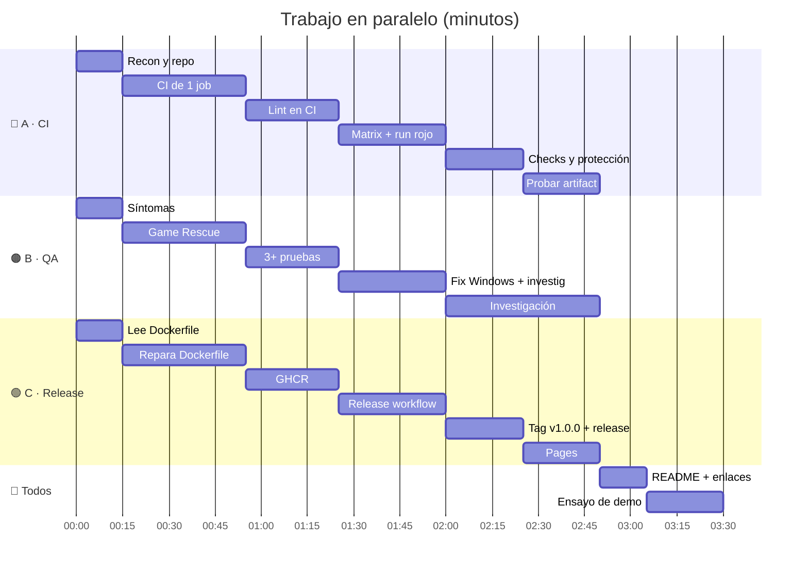

# 🕹️ Arcade Rescue
### De build roto a release

**Prioridad:** `build` → `pruebas` → `CI` → `release` → `Docker` → `Pages`

> [!IMPORTANT]
> Los workflows se escriben **a mano** y se tienen que poder explicar. Sin evidencia en GitHub (runs, artifacts, releases, paquetes, URLs), no cuenta.

---

## 👥 Equipo

| | Persona | Rol | Archivos propios |
|:-:|---|---|---|
| 🔵 | **A:** ________ | Build master y CI | `CMakeLists.txt` · `ci.yml` · `.clang-format` · `.clang-tidy` |
| 🟠 | **B:** ________ | QA y Game Rescue | `src/` · `include/` · `tests/` · `docs/investigacion.md` |
| 🟢 | **C:** ________ | Release, Docker y Pages | `Dockerfile` · `release.yml` · `docs/` · `README.md` |

**Reglas de Git:** una rama por tarea (`fix/…`, `ci/…`, `docker/…`) · un commit = una intención (`fix:`, `ci:`, `docs:`, `test:`) · no editar archivos ajenos sin avisar · sin `build/` ni secretos en el repo.

---

## ⏱️ Cronograma (210 min)

<b>Ver el detalle por tramo</b>

| Min | 🔵 A | 🟠 B | 🟢 C |
|---|---|---|---|
| 0–15 | **Todos:** clonar, compilar tal cual, anotar síntomas | Lista de síntomas | Lee el Dockerfile y guarda errores |
| 15–55 | Workflow de 1 job (lint+test+build, Linux) | Corregir bugs, 1 commit por bug | Reparar Dockerfile; esqueleto de `docs/` |
| 55–85 | clang-format / clang-tidy en CI | 3+ pruebas; una falla con el código heredado | Workflow de GHCR |
| 85–120 | Matrix Linux/Windows + **run rojo provocado** | Fallos de Windows; empezar investigación | Workflow de release y artifacts |
| 120–145 | Checks y protección de `main` | Investigación | Tag `v1.0.0` y release |
| 145–170 | Descargar artifact y ejecutarlo fuera del runner | Terminar investigación | `docker pull` de prueba; activar Pages |
| 170–185 | **Todos:** README, uso de IA declarado, enlaces en ventana privada | | |
| 185–210 | **Todos:** ensayo cronometrado de la demo | | |

> [!TIP]
> Más de 10 minutos atascado: rotar roles o pedir pista.

---

## ✅ Checklists

> Las casillas **marcables con el clic** están en los [Issues del repo](../../issues). Aquí es el resumen.

<b>🔵 Persona A · Build master y CI</b>

- [ ] Repo con `.gitignore` y commit inicial «chore: estado inicial del proyecto heredado»
- [ ] CI en `push` y `pull_request` (lint, test y build separados)
- [ ] Matrix Linux + Windows, dos jobs verdes
- [ ] Run rojo provocado y luego revertido
- [ ] `clang-format` versionado; `clang-tidy` o alternativa justificada
- [ ] Artifact descargado y ejecutado en otra máquina

<b>🟠 Persona B · QA y Game Rescue</b>

- [ ] Síntomas con pasos de reproducción
- [ ] Un commit `fix:` por síntoma, con PR
- [ ] 3+ pruebas con `ctest`, deterministas
- [ ] Una prueba falla con el código heredado y pasa tras el fix (guardar evidencia)
- [ ] `docs/investigacion.md` con las 7 preguntas
- [ ] Herramienta implementada (sugerida: ASan/UBSan)

<b>🟢 Persona C · Release, Docker y Pages</b>

- [ ] Dockerfile reparado, smoke test con salida 0
- [ ] Imagen en GHCR etiquetada por versión; `docker pull` funciona
- [ ] Artifacts con nombre por plataforma
- [ ] Tag anotado `v1.0.0` y release con binarios y notas
- [ ] Pages público con instrucciones, descargas y créditos
- [ ] README con build, pruebas, distribución, badges y uso de IA

---

## 🏁 Definición de terminado

> [!CAUTION]
> Los 8 son obligatorios. Si falta uno, la entrega está incompleta.

| # | Requisito | Dueño |
|:-:|---|:-:|
| 1 | Build limpio en Linux y Windows | 🔵 |
| 2 | Lint en el pipeline | 🔵 |
| 3 | 3+ pruebas, una falla con el código heredado | 🟠 |
| 4 | Artifacts descargables de un run | 🔵 |
| 5 | Release `v1.0.0` con binarios y notas | 🟢 |
| 6 | Imagen en GHCR | 🟢 |
| 7 | Pages publicado con enlaces funcionales | 🟢 |
| 8 | Demo de 5 minutos ensayada | 👥 |

---

## 🎤 Demo

**Reparto:** 🔵 pipeline y run rojo · 🟠 un bug concreto + su prueba + investigación · 🟢 release, GHCR y Pages. *Quien habla no navega.*

**Pestañas abiertas antes de empezar:** Actions (verde y rojo) · release `v1.0.0` · paquete GHCR · Pages · `investigacion.md` · terminal.

<b>Preguntas probables del profesor</b>

1. ¿Por qué esa prueba y qué bug atrapa?
2. Muestra un run rojo y su arreglo.
3. ¿Dónde vive el token y por qué no está en el repo?
4. ¿Diferencia entre artifact y release?
5. ¿Por qué la imagen no ejecuta la GUI?
6. ¿Qué pasa si cambia la versión de una dependencia?
7. ¿Qué se pierde si cae el runner de Windows?

---

## ⭐ Retos opcionales (tope +10)

| Reto | Pts | Reto | Pts |
|---|:-:|---|:-:|
| Runner self-hosted | +2 | Docker multi-stage | +1 |
| Cobertura (gcovr) | +2 | Dependabot | +1 |
| Sanitizers | +2 | Release notes automáticas | +1 |
| Firma de artifacts | +2 | Cache de dependencias | +1 |
| Pages disparado por tag | +1 | | |
